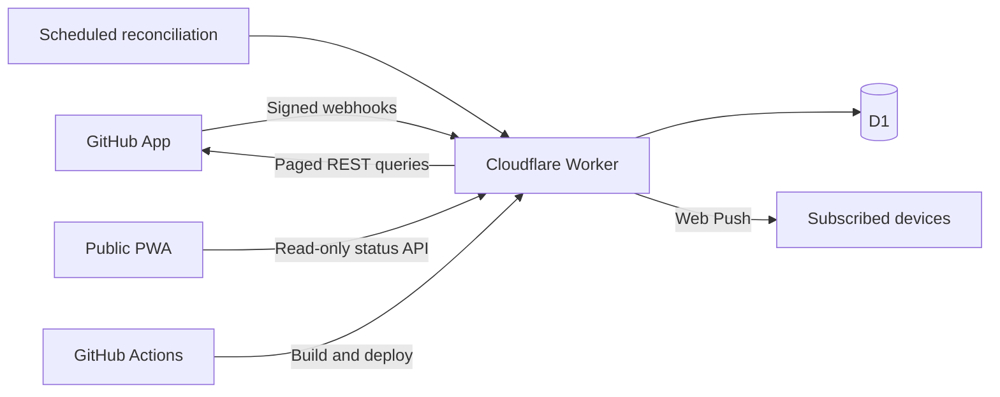

# Architecture

## Target design

The current source includes the PWA, owner authorization, saved public scope,
complete Actions scans, signed ingestion, and owner-activated scheduled
reconciliation. D1 sessions, scope, manual checks and the signed receiver have
been deployed. Scheduled reconciliation and public live status are deployed with checks
paused, pending owner activation. A real signed completed-workflow event and
its persisted terminal run/attempt are verified. Push remains
planned. See [reconciliation.md](reconciliation.md) for the new runtime contract.

## Frontend and framework choice

Use React + TypeScript + Tailwind with Vite and the Cloudflare Vite plugin.
Selected MIT components from the upstream Next.js dashboard work as ordinary
React components; their interface does not require Next.js rendering or routing.
Vite avoids bringing the upstream's duplicate Next.js config and browser token
management into the new project. One Worker serves static assets and `/api/*`.

The demo is frontend-only and explicitly selected by `?demo=1`; it cannot affect
backend monitoring or dispatch notifications. User filters affect rendering only.
The service worker caches only an offline document; status and authenticated
requests are not cached. Cross-device install and push checks remain required.

## GitHub access and coverage

Register a GitHub App with Actions: read and mandatory Metadata: read. Subscribe
to workflow run/job events plus installation and repository lifecycle changes
needed to maintain coverage. Request no content, administration, or Actions
write access. Validate actual event action types with a sandbox repository.

GitHub user authorization establishes an eight-hour signed owner session. PKCE,
random state and a five-minute browser-bound cookie protect the callback. An
owner allowlist compares the returned immutable GitHub user ID to configuration.
The identity access token is used once for `/user`, then discarded; no refresh
token is requested or persisted. Installation access is
separate: install on all repositories owned by the personal account and add
organization installations as authorized. Reconcile repository membership using
all pages. Do not equate a user's accessible repos to one installation's repos.
Define and display any needed polling coverage for collaborator repositories.

App private keys, webhook secret, OAuth client secret, session signing key and
Web Push private key belong in Worker secrets. This identity milestone does not
persist provider tokens. Installation tokens will be short-lived and renewed as
needed for tracking. The read-only public status endpoint returns no credentials,
user email, subscription endpoints, or private repository details. The owner ID
and APP_ORIGIN are non-secret configuration. Query strings are redacted from
platform logs/traces and invocation logs are disabled to avoid retaining OAuth
authorization codes. Authentication application logs contain only a fixed
failure event name and an allowlisted outcome, never raw provider error data.

The persistent-session change issues an additional random session ID in the
signed, HttpOnly cookie and stores only its SHA-256 hash and owner/login/lifetime
metadata in D1. Every owner request verifies both the cookie and the database
record. Reads start with `first-primary` so a recent revocation cannot be hidden
by a stale replica. Expired records are removed during successful session creation
in the same D1 batch as the insert.

Single-device logout removes that session record; all-device logout removes all
records for the configured owner. Copies of those cookies stop authorizing
requests. Both operations require POST and an exact matching browser Origin.
Missing storage, failed reads/writes and legacy cookies without a stored session
fail closed. After deployment, existing stateless sessions must sign in again.
Rotating SESSION_SECRET or changing owner ID also invalidates existing cookies.
No public mutation endpoints are enabled. The
repository inventory is a read operation and does not persist configuration or
start monitoring.

## Monitoring visibility policy

The owner verified 21 accessible repositories and chose to monitor only the four
public repositories: github-nanny, locus-tether, verify, and the required
stormbots/Tactics-Strategy-Dev-Environments repository. The 17 private
repositories are access-inventory metadata only and must not receive Actions
queries or contribute to busy/idle, the activity latch, or notifications. The
persisted monitoring scope contains only public records. Future ingestion and
scans must revalidate visibility and access before using those records; an old
saved inventory cannot establish current scope, activity, or idle.

## Saved public scope and disconnect

The owner-only `/api/admin/monitoring` endpoint reads the saved scope with GET,
verifies fresh access and saves with POST, and clears it with DELETE. Mutations
require the exact canonical Origin and all methods reject cross-site Fetch
Metadata. An authenticated settings visit reads D1 once; it does not call GitHub.
The existing access-check button remains read-only and never saves automatically.
Caller bodies and query parameters cannot supply repositories or coverage.

A save takes the current stored revision, then verifies every configured account
with the existing bounded discovery pipeline. Every account and required public
repository must succeed. The single D1 scope document stores installation/account
identifiers and explicit public repository records only; private names, private
counts and installation tokens are not persisted. All accounts in a verification
share one timestamp. Empty or over-200-public-repository scopes are rejected
without saving a subset. This bound keeps the document below D1's row limit.

One `UPDATE ... WHERE revision = ? RETURNING revision` atomically replaces the
document and increments its revision. Concurrent saves cannot both win the same
revision. Disconnect clears the document and increments the revision, even if
already disconnected, so an older in-flight save cannot silently restore it.
It does not uninstall the App or revoke owner sessions. Sign-out does not clear
the saved scope. D1 reads begin on the primary, and storage failures fail closed.

The saved record includes a configuration key derived from the App identity,
owner, organization IDs and required repository names, and public-only policy.
If that server configuration changes, old scope records are treated as
unprepared and hidden until fresh verification. A failed save preserves the
previous document; it makes no claim of current access. The UI clears its old
scope on a failed operation and offers an explicit reload.

Saved scope is preparation only: public status remains unknown/unconnected
until the owner starts automatic checks. Manual checks remain explicit. The
signed receiver records event evidence without calling GitHub; the scheduled
runner reconciles only when enabled. Notification delivery remains disabled. Scan results are fenced by
both the scope revision and the monitor revision. Scope replacement/disconnect
atomically resets monitor state and removes pending outbox work.

## Manual Actions observation

`POST /api/admin/actions` requires the owner session, canonical application
origin and an exact matching Origin; cross-site Fetch Metadata is rejected.
Only the settings button starts a check. Page visits, scope saves/reloads,
public dashboard refreshes and timers do not call it. Caller bodies/queries
cannot choose repositories, actors or branches.

The handler reads the prepared scope from D1, repeats full installation discovery
and requires the newly verified public repository IDs, names, accounts and
installations to match that saved scope. A changed or newly private repository
requires deliberate scope verification/save before scanning. Installation tokens
are captured only in a request-local map after inventory verification, never in
the report, browser, database or logs.

For each saved public repository, verify its immutable ID, owner, full name and
public visibility with metadata before run queries. Query every page of each
documented unfinished status: queued, in_progress, requested, waiting, pending.
Do not filter actor, branch, event or workflow. Each returned run must belong
to that public repository, match the requested status, have no terminal
conclusion and carry valid IDs/attempt/timestamps. Simultaneous runs sharing a
workflow remain separate. Duplicate IDs across pages/statuses, including an
attempt changing mid-scan, invalidate the observation rather than choose one.
Run links are built from the verified repository and run ID/attempt; supplied
URLs, logs, commit/profile data and head-repository metadata are discarded.

Totals must remain stable, equal the unique returned count and agree with page
sizes/next links. The GitHub status-filtered endpoint caps searches at 1,000
results; a total at or above 1,000 is rejected as potentially truncated. Provider
next links are never followed. Discovery and run/metadata requests share a
40-request budget, a 25-second request deadline, 10-second individual timeouts
and a 2-MiB bound per JSON response. No automatic retries are added. Four repos
with single-page inventories/statuses use 34 GitHub requests: six discovery,
twenty status queries and eight metadata reads. Pagination consumes remaining
budget; larger scopes need future batched reconciliation.

After all run queries, recheck public metadata for every repository and read
the D1 scope again from the primary. Disconnect or another scope save changes
the revision and rejects the in-flight result. Detected access/visibility
changes, rate limits, provider errors, deadlines, oversized/malformed responses
or incomplete pages return fixed errors with no partial runs. Visibility can
still change immediately after the final check; distributed reads are not an
atomic GitHub snapshot. Manual observations while paused are not published. After activation, only
a fresh complete observation under the current scope can be published. The
durable-state change stores only its sanitized run fields after successful
monitor/scope revision checks, with a 256-KiB bound on the complete run document.
Oversized observations fail rather than persist a truncated subset.

The response contains scan start/end time, scope revision, repository count and
explicit unfinished runs with their attempt numbers. A failed retry clears the
prior UI observation; changing/reloading scope and sign-out also clear it.
An empty check alone cannot assert public global idle. The internal activity
latch and quiet-period state are persisted. The owner confirmed all five
unfinished statuses block idle. Scheduled checks and the public feed are
described in reconciliation.md; push delivery remains a subsequent milestone. The owner verified a running workflow in the required organization
and its persisted busy state/activity latch in hosted D1.

## Signed event ingestion

`POST /api/webhooks/github` authenticates the unmodified raw body with Web Crypto
HMAC SHA-256 and a dedicated Worker/GitHub App secret. It fails closed without
that secret. Payloads are bounded to 1 MiB; signed bytes are verified before
UTF-8 decoding, JSON parsing or database access. Headers, method, media type and
canonical origin are validated. Fixed responses/logs never include raw payloads,
signatures, profile information or provider URLs. See [webhooks.md](webhooks.md)
for the receiver contract and owner setup instructions.

Current App/owner/organization configuration must match the saved scope key.
Workflow evidence must match a saved public repository's immutable ID, owner,
full name and installation. Unconfigured/private repositories produce no
receipts or activity. A formerly monitored repository becoming private clears
scope rather than counting that private activity.

Migration 0004 adds globally unique delivery receipts and a latest-attempt run
ledger. One D1 batch inserts a receipt under the current scope/configuration,
updates only meaningful/newer evidence and increments monitor revision for
fresh activity. Terminal attempts cannot reopen; old attempts cannot close a
new rerun. Commit markers prevent duplicate/losing writes from acting on another
delivery. Failures roll back the receipt and state together. The storage layer
also checks actual saved public IDs, independently of its caller.

Fresh evidence, including completion, sets unknown, arms activity, clears cached
runs/quiet candidate and cancels an unsent prior notice. It invalidates in-flight
scans but never asserts idle or starts a provider query. REST observations record
seen attempts and stabilized-idle accounting times without inferring terminal
status. A late completion for an already covered period cannot rearm a duplicate
idle cycle; an unseen fast run or a new attempt still can. REST results that
contradict a signed terminal/higher attempt are rejected.

Signed installation/selection/repository coverage-loss events atomically clear
scope, run state and pending notices. Receipt tombstones survive scope changes
so redelivery cannot clear a fresh owner save again. Expired/pre-scope events
are ignored. Accepted deliveries opportunistically remove up to 50 expired
receipts and run records after seven days; scheduled cleanup is still planned.
Public status is exposed only after owner activation and fresh complete
reconciliation. Notification readiness stays off in this milestone.

## Owner repository inventory

`GET /api/admin/repositories` requires a valid owner session, the canonical
application origin, and no cross-site Fetch Metadata indication. It only runs
after an explicit click in `/settings`, with no timer, cron, or Actions requests.

The backend signs a nine-minute RS256 JWT using the existing Client ID as issuer
and a 60-second clock-skew allowance. GitHub's PKCS#1 PEM key is wrapped as
PKCS#8 for native Web Crypto import; unencrypted PKCS#8 is also accepted. No key
material or token enters the frontend. Keys must be RSA with 2048–8192 bits.

The owner login from the signed session locates the personal App installation.
Additional organizations come from the server's `GITHUB_ORGANIZATIONS` JSON
allowlist, using immutable organization IDs, login names and required public
repository names. Each returned account ID and User/Organization type must
match its configured scope. All installations must be active and grant only
Actions: read and Metadata: read. A separate installation token is requested
with exactly those permissions and no
repository subset. Tokens exist only within the request and expire at GitHub;
they are neither persisted nor returned to the browser.

Repository pages use fixed api.github.com paths, with 100 items per page and a
20-page budget per account. A shared 40-request budget bounds the entire check,
including installation lookups and token creation. Declared totals
must remain consistent and match unique IDs; duplicates, short/empty pages with
remaining items, extra next links, foreign owners, malformed data, and over-budget
or over-2-MiB page responses reject that account's inventory. Redirects are rejected in
manual mode. Fixed error categories handle provider failures without copying
provider bodies or exception text into logs or HTTP responses.

The response exposes public repository names/links, the private repository count,
and whether each installation uses All or selected repositories. Missing or
unapproved installations are explicit account failures; missing required public
repositories are listed from configuration. The overall result is complete only
when every configured account succeeds, every required repository is visible,
and the personal account uses All repositories. A selected organization
installation can satisfy its explicit required-repository floor.

Production requires `stormbots/Tactics-Strategy-Dev-Environments` under immutable
organization ID `5925283`. Other accounts installing the public App are ignored,
and browser parameters cannot expand scope. Missing/blank/malformed organization
configuration fails closed; local personal-only tests explicitly use `[]`.

This is still not an inventory of every collaborator repository accessible to
the GitHub user. Coverage outside the configured accounts remains unverified.
The inventory check cannot establish global idle. Before automatic activation,
the public status API remains unknown
and unconnected. A failed UI retry clears the old report; a partial report
labels the missing accounts and cannot claim configured access is complete.

## Idle decision and races

`worker/monitor.ts` contains the primitive idle reducer and a stabilization
wrapper with emptySince and lastCompleteAt alongside phase, activityObserved,
revision and idleEpoch. It does not call GitHub, commit state or send push itself.

Fresh activity increments the revision and arms a future notice. Start a scan
with that revision; query the entire monitoring scope using complete pagination
and explicit nonterminal status handling. No latest-N shortcut is sufficient.
Accept a zero-active result only if every query succeeded and the revision is
still current. A new webhook during the scan invalidates its result. Repeat
reconciliation after a brief stabilization interval to accommodate chained
workflows and delayed events before launch. No distributed scan can guarantee
that GitHub will not start a new run immediately afterward.

`MonitorStore` takes a token before scanning, using a primary D1 read joined to
the exact prepared scope/configuration. A successful complete scan atomically
compares both revisions, saves sanitized current runs and monitor state, and
conditionally inserts one outbox row keyed by the global idle epoch in a D1
batch. A unique random commit marker ensures follow-up SQL cannot act on another
Worker's successful update when its own compare-and-swap lost. An outbox failure
rolls back the state change. Competing or replayed scan tokens cannot both win.

The first empty check records a candidate and phase unknown. Only a second
complete scan that STARTED at least ten seconds after the first empty check
finished can stabilize idle; a long first scan is insufficient. A candidate
older than two minutes expires and requires a new pair of scans. Initial idle is
silent. Observed active runs arm a later epoch; another active run clears the
candidate and cancels an unsent old idle notice. A failed scan breaks the quiet
interval, clears run details and sets unknown while retaining the activity
latch. Pending notices are paused while unknown, so coverage recovery can
release the same epoch rather than lose it. A future dispatcher must require
enabled notices, current scope/epoch, fresh complete state and phase idle before
sending, and revalidate visibility of the relevant link.

Migration 0003 creates monitor_state and idle_outbox, initialized against the
existing scope revision. notice_enabled defaults to zero and has no public or
owner API to enable it in this milestone. No outbox rows can be created by
production-default manual checks, even after internal stabilization. Tests
enable it only in isolated D1 fixtures to verify the real transactional path.
Activation must reset state with fresh coverage after webhook/reconciliation
integration; enabling this flag alone is not a supported rollout operation.
Internal phase values are not exposed as public current status or notifications.

Scope save/disconnect batches reset monitor confidence, activity, runs, quiet
candidate, link and notification readiness and remove pending old-scope notices
in the same transaction. Epochs remain monotonic and are never reused. This also
fences already-running scans. A missing migration or failed cleanup rolls back
the scope change and fails closed. No credentials enter the stored run document.
If the previous deployed Worker saves scope between migration and code upload,
the first new scan repairs only the scope-revision mismatch, resetting confidence
and notice readiness and clearing obsolete outbox work before taking its token.

The webhook ledger stores only latest-attempt IDs/status/timing and delivery
IDs, not full payloads or a history view. Signing and ordering are runtime-tested;
real GitHub delivery verification remains after deployment and secret setup.

Push delivery consumes the outbox with per-device delivery tracking and retry
backoff. A notice is not marked sent before a push service accepts it. An ambiguous
network failure can duplicate delivery; use a stable notification tag per epoch
to reduce duplicates. Expired subscriptions are removed. Do not promise exact
once display on all devices.

## Planned persistent data

| Record | Purpose |
| --- | --- |
| Saved public scope (implemented) | Atomic account/installation and public repository document, configuration key, revision, verification time |
| Repository monitoring state | Revalidated visibility, current access health and successful scan time |
| Runs/attempts (implemented) | Sanitized active-run document and latest signed attempt/status with REST accounting time |
| Webhook deliveries (implemented) | Unique delivery IDs, scope generation and receive time, with opportunistic expiry cleanup |
| Monitor state (implemented) | Scope/revision fencing, phase, activity latch, epoch, quiet candidate, last complete scan, disabled notice readiness |
| Push subscriptions | Private endpoint and keys for each authorized device |
| Notification outbox (atomic creation implemented, disabled) | Stable epoch and relevant run link; delivery/retry state still planned |

Internal short retention for notice links/deduplication does not imply a history
view. Avoid retaining workflow logs or full webhook payloads unnecessarily.

## Reconciliation and API budget

Webhooks give prompt evidence; scheduled scans repair missed activity and refresh
scope. Use a hosted scheduler, not a GitHub Actions polling workflow: running a
monitoring workflow itself creates activity and can interfere with global idle.
Include github-nanny's ordinary CI/deployment runs in monitoring once installed.

Choose cadence after measuring repository count. A scan of N repositories with S
separate status queries costs at least N*S API requests before pagination. At one
scan/minute, that is 60*N*S/hour; for 20 repos and two statuses, 2,400/hour before
other API work. Job events can be numerous. Coalesce overlapping scans, bound
concurrency, honor rate-limit headers, and back off. If a scan exceeds Worker
subrequest/CPU limits, split work into batches and publish a result only when
the complete scan generation finishes. Unknown is preferable to false idle.

## Sources

- https://developers.cloudflare.com/workers/framework-guides/web-apps/react/
- https://developers.cloudflare.com/workers/vite-plugin/tutorial/
- https://developers.cloudflare.com/workers/ci-cd/external-cicd/github-actions/
- https://docs.github.com/en/rest/actions/workflow-runs
- https://docs.github.com/en/webhooks/webhook-events-and-payloads
- https://docs.github.com/en/apps/using-github-apps/authorizing-github-apps
- https://developers.cloudflare.com/d1/worker-api/d1-database/
