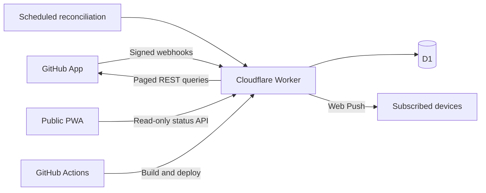

# Architecture

## Target design

The current implementation contains the PWA shell, honest unknown-status API,
a pure idle-decision function, owner authorization handlers, and an owner-only
repository inventory check. D1, scheduled
handlers, webhook ingestion and push delivery are planned, not active. See
roadmap.md for boundaries and github-connection.md for the sign-in contract.

## Frontend and framework choice

Use React + TypeScript + Tailwind with Vite and the Cloudflare Vite plugin.
Selected MIT components from the upstream Next.js dashboard work as ordinary
React components; their interface does not require Next.js rendering or routing.
Vite avoids bringing the upstream's duplicate Next.js config and browser token
management into the new project. One Worker serves static assets and `/api/*`.

The demo is frontend-only and explicitly selected by `?demo=1`; it cannot affect
backend monitoring or dispatch notifications. User filters affect rendering only.
The service worker caches only an offline document; status and authenticated
requests are not cached. Cross-device install and push checks remain required.

## GitHub access and coverage

Register a GitHub App with Actions: read and mandatory Metadata: read. Subscribe
to workflow run/job events plus installation and repository lifecycle changes
needed to maintain coverage. Request no content, administration, or Actions
write access. Validate actual event action types with a sandbox repository.

GitHub user authorization establishes an eight-hour signed owner session. PKCE,
random state and a five-minute browser-bound cookie protect the callback. An
owner allowlist compares the returned immutable GitHub user ID to configuration.
The identity access token is used once for `/user`, then discarded; no refresh
token is requested or persisted. Installation access is
separate: install on all repositories owned by the personal account and add
organization installations as authorized. Reconcile repository membership using
all pages. Do not equate a user's accessible repos to one installation's repos.
Define and display any needed polling coverage for collaborator repositories.

App private keys, webhook secret, OAuth client secret, session signing key and
Web Push private key belong in Worker secrets. This identity milestone does not
persist provider tokens. Installation tokens will be short-lived and renewed as
needed for tracking. The read-only public status endpoint returns no credentials,
user email, subscription endpoints, or private repository details. The owner ID
and APP_ORIGIN are non-secret configuration. Query strings are redacted from
platform logs/traces and invocation logs are disabled to avoid retaining OAuth
authorization codes. Authentication application logs contain only a fixed
failure event name and an allowlisted outcome, never raw provider error data.

Logout clears the browser session cookie; signed cookies already copied to
another client are not centrally revoked and expire within eight hours. Rotating
SESSION_SECRET or changing the configured owner invalidates existing sessions.
Server-side session revocation can be introduced with D1 before more powerful
owner operations are added. No public mutation endpoints are enabled. The new
repository inventory is a read operation and does not persist configuration or
start monitoring.

## Owner repository inventory

`GET /api/admin/repositories` requires a valid owner session, the canonical
application origin, and no cross-site Fetch Metadata indication. It only runs
after an explicit click in `/settings`, with no timer, cron, or Actions requests.

The backend signs a nine-minute RS256 JWT using the existing Client ID as issuer
and a 60-second clock-skew allowance. GitHub's PKCS#1 PEM key is wrapped as
PKCS#8 for native Web Crypto import; unencrypted PKCS#8 is also accepted. No key
material or token enters the frontend. Keys must be RSA with 2048–8192 bits.

The owner login from the signed session locates the personal App installation.
Additional organizations come from the server's `GITHUB_ORGANIZATIONS` JSON
allowlist, using immutable organization IDs, login names and required public
repository names. Each returned account ID and User/Organization type must
match its configured scope. All installations must be active and grant only
Actions: read and Metadata: read. A separate installation token is requested
with exactly those permissions and no
repository subset. Tokens exist only within the request and expire at GitHub;
they are neither persisted nor returned to the browser.

Repository pages use fixed api.github.com paths, with 100 items per page and a
20-page budget per account. A shared 40-request budget bounds the entire check,
including installation lookups and token creation. Declared totals
must remain consistent and match unique IDs; duplicates, short/empty pages with
remaining items, extra next links, foreign owners, malformed data, and over-budget
or over-2-MiB page responses reject that account's inventory. Redirects are rejected in
manual mode. Fixed error categories handle provider failures without copying
provider bodies or exception text into logs or HTTP responses.

The response exposes public repository names/links, the private repository count,
and whether each installation uses All or selected repositories. Missing or
unapproved installations are explicit account failures; missing required public
repositories are listed from configuration. The overall result is complete only
when every configured account succeeds, every required repository is visible,
and the personal account uses All repositories. A selected organization
installation can satisfy its explicit required-repository floor.

Production requires `stormbots/Tactics-Strategy-Dev-Environments` under immutable
organization ID `5925283`. Other accounts installing the public App are ignored,
and browser parameters cannot expand scope. Missing/blank/malformed organization
configuration fails closed; local personal-only tests explicitly use `[]`.

This is still not an inventory of every collaborator repository accessible to
the GitHub user. Coverage outside the configured accounts remains unverified.
The check cannot establish global idle. The public status API remains unknown
and unconnected. A failed UI retry clears the old report; a partial report
labels the missing accounts and cannot claim configured access is complete.

## Idle decision and races

`worker/monitor.ts` contains a pure decision function with four state fields:
phase, activityObserved, revision, and idleEpoch. It does not call GitHub, commit
state, or send push itself.

Fresh activity increments the revision and arms a future notice. Start a scan
with that revision; query the entire monitoring scope using complete pagination
and explicit nonterminal status handling. No latest-N shortcut is sufficient.
Accept a zero-active result only if every query succeeded and the revision is
still current. A new webhook during the scan invalidates its result. Repeat
reconciliation after a brief stabilization interval to accommodate chained
workflows and delayed events before launch. No distributed scan can guarantee
that GitHub will not start a new run immediately afterward.

The future persistence layer must atomically compare-and-swap the revision,
update monitor state, and enqueue an outbox notice with unique idleEpoch in a D1
transaction/batch. This prevents two Workers from creating separate notices for
the same transition. Webhook delivery IDs need a unique constraint. Attempts and
out-of-order events must not reopen a completed run incorrectly.

Push delivery consumes the outbox with per-device delivery tracking and retry
backoff. A notice is not marked sent before a push service accepts it. An ambiguous
network failure can duplicate delivery; use a stable notification tag per epoch
to reduce duplicates. Expired subscriptions are removed. Do not promise exact
once display on all devices.

## Planned persistent data

| Record | Purpose |
| --- | --- |
| Account/installations | Allowed owner ID, installation IDs, coverage health |
| Repositories | Scope, visibility, access state, successful discovery time |
| Runs/attempts | Every unfinished run, status, run URL, event ordering metadata |
| Webhook deliveries | Idempotency and processing result with bounded retention |
| Monitor state | Phase, revision, activity latch, epoch, last complete scan |
| Push subscriptions | Private endpoint and keys for each authorized device |
| Notification outbox | Stable epoch, relevant completed-run links, retry state |

Internal short retention for notice links/deduplication does not imply a history
view. Avoid retaining workflow logs or full webhook payloads unnecessarily.

## Reconciliation and API budget

Webhooks give prompt evidence; scheduled scans repair missed activity and refresh
scope. Use a hosted scheduler, not a GitHub Actions polling workflow: running a
monitoring workflow itself creates activity and can interfere with global idle.
Include github-nanny's ordinary CI/deployment runs in monitoring once installed.

Choose cadence after measuring repository count. A scan of N repositories with S
separate status queries costs at least N*S API requests before pagination. At one
scan/minute, that is 60*N*S/hour; for 20 repos and two statuses, 2,400/hour before
other API work. Job events can be numerous. Coalesce overlapping scans, bound
concurrency, honor rate-limit headers, and back off. If a scan exceeds Worker
subrequest/CPU limits, split work into batches and publish a result only when
the complete scan generation finishes. Unknown is preferable to false idle.

## Sources

- https://developers.cloudflare.com/workers/framework-guides/web-apps/react/
- https://developers.cloudflare.com/workers/vite-plugin/tutorial/
- https://developers.cloudflare.com/workers/ci-cd/external-cicd/github-actions/
- https://docs.github.com/en/rest/actions/workflow-runs
- https://docs.github.com/en/webhooks/webhook-events-and-payloads
- https://docs.github.com/en/apps/using-github-apps/authorizing-github-apps
