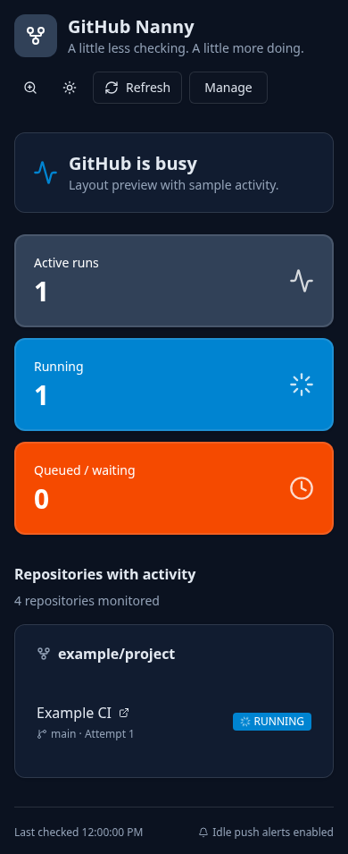
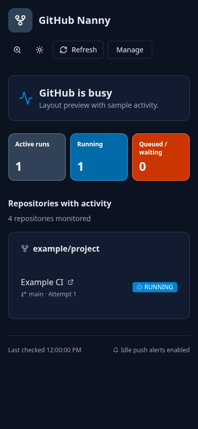

# Compact mobile dashboard

Issues #23 and #24 keep the three run filters beside each other at normal mobile
text sizes, remove their decorative icons, and remove the header tagline.
The filters still select which runs are displayed; they do not change monitoring.

At a 390 × 844 CSS-pixel viewport, the filter row shrank from 336 to 94 pixels.
The activity heading moved from y=630 to y=388, saving 242 pixels. The first
repository in this sample is fully visible without scrolling. Actual content,
viewport height, and text settings affect how much activity is visible.

Both full-page captures use the same viewport, dark theme, and synthetic activity
labelled “Layout preview with sample activity.” They do not show live status.

| Before | After |
| --- | --- |
|  |  |

The grid uses a rem-based minimum width so enlarged text can reflow into fewer
columns. Labels and counts wrap instead of clipping, including values beyond
four digits. Blue and orange backgrounds are slightly darker to retain readable
small white labels. Selected state, keyboard focus, minimum 44-pixel target
height, zero counts, and unknown-status dashes are preserved.

Browser smoke covers 320, 360, 390, and 1440-pixel widths; 200% text; compact
mode; keyboard filtering; four-digit and larger counts; no horizontal overflow;
and label contrast in both themes. It checks tagline removal in live and demo
views. Full local checks and a Wrangler deployment dry run passed before PR CI.
